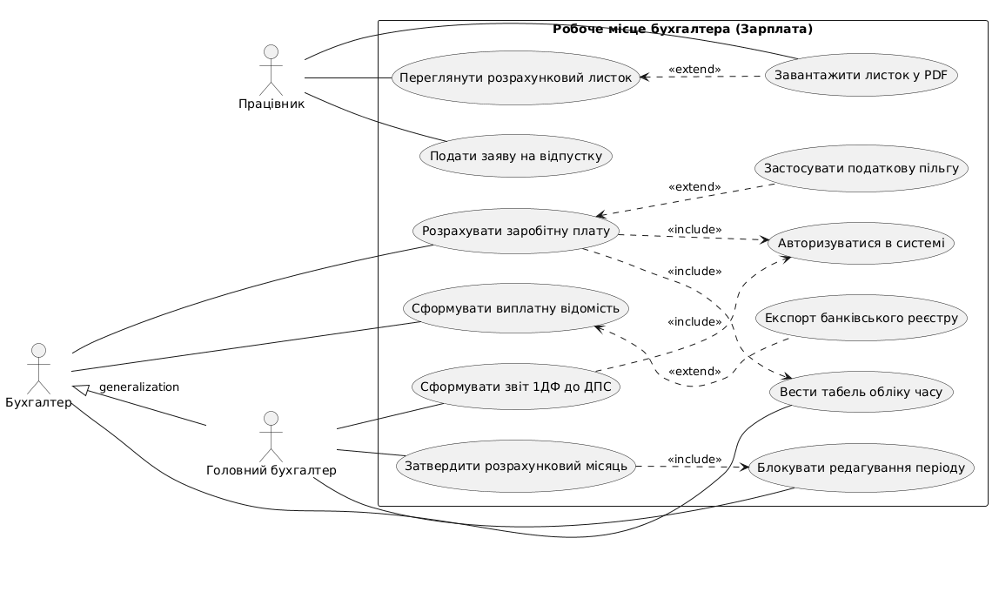
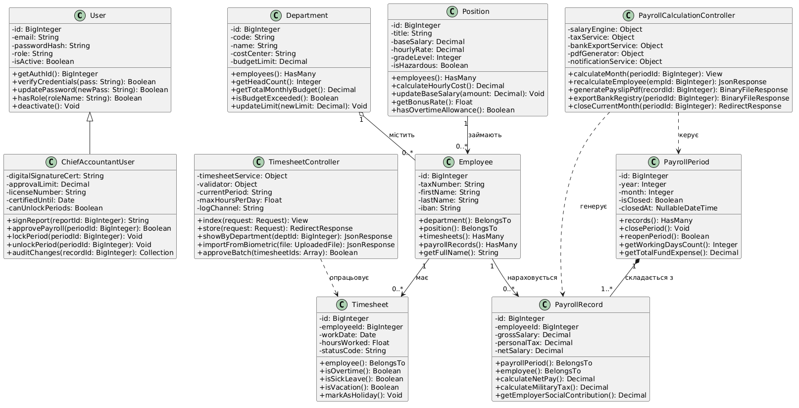

# Архітектура та системне проєктування веб-системи
## Тема: Робоче місце бухгалтера з нарахування заробітної платні

---

## 1. Аналіз предметної галузі

### 1.1. Призначення системи та основні функції
Система призначена для автоматизації процесів обліку робочого часу, розрахунку основної та додаткової заробітної плати співробітників, обчислення обов’язкових податків і зборів, а також формування платіжних відомостей і регламентованої податкової звітності.

**Основні функції:**
1. **Облік робочого часу:** ведення електронних табелів обліку робочого часу, фіксація фактично відпрацьованих годин, нічних змін, вихідних днів, а також відхилень (лікарняні, відпустки, відрядження).
2. **Розрахунок заробітної плати:** автоматичне нарахування посадових окладів, оплати за тарифними ставками, надурочних, премій, доплат за вислугу років та відпускних виплат.
3. **Розрахунок податкових зобов'язань:** обчислення податку на доходи фізичних осіб (ПДФО), військового збору (ВЗ), єдиного соціального внеску (ЄСВ) з урахуванням податкової соціальної пільги (ПСП).
4. **Формування виплатних документів:** генерація авансових і зарплатних розрахунково-платіжних відомостей, формування банківських реєстрів для виплати коштів на карткові рахунки працівників (IBAN).
5. **Аналітика та експорт звітності:** формування персональних розрахункових листків, аналітичних звітів щодо фонду оплати праці (ФОП) за підрозділами та податкового розрахунку (форма 1ДФ).

### 1.2. Користувачі системи (Актори)
* **Працівник (Employee):** переглядає деталізацію своїх нарахувань, завантажує персональний розрахунковий листок, подає заяви на відпустку.
* **Бухгалтер з заробітної плати (Payroll Accountant):** заповнює табелі, проводить нарахування зарплати, премій і надбавок, формує платіжні відомості.
* **Головний бухгалтер (Chief Accountant):** володіє всіма правами бухгалтера, а також затверджує підсумковий розрахунок за місяць, накладає цифровий підпис, блокує закриті періоди для редагування та формує звіти для податкових органів.

### 1.3. Архітектура системи
Система проєктується за патерном **MVC (Model-View-Controller)** на базі фреймворку **Laravel (PHP)**:
* **Model (Eloquent ORM):** представлення бізнес-сутностей, інкапсуляція правил обробки даних, зв'язків між таблицями бази даних та бізнес-правил нарахування.
* **View (Blade / API JSON Resource):** інтерфейс взаємодії користувача з системою для відображення таблиць табелів, відомостей і звітних графіків.
* **Controller:** координація HTTP-запитів, валідація вхідних даних (через Form Requests), делегування бізнес-розрахунків сервісним класам та повернення результатів користувачу.

### 1.4. Основні сутності та таблиці бази даних
1. `User` (таблиця `users`): автентифікація, ролі доступу та облікові записи.
2. `Department` (таблиця `departments`): організаційна структура та центри витрат підприємства.
3. `Position` (таблиця `positions`): посади, базові оклади, годинні ставки та грейди.
4. `Employee` (таблиця `employees`): персональні дані співробітників, податковий номер (РНОКПП), рахунок IBAN.
5. `Timesheet` (таблиця `timesheets`): щоденний/підсумковий табель обліку робочого часу.
6. `PayrollPeriod` (таблиця `payroll_periods`): розрахункові календарні місяці зі статусом блокування.
7. `PayrollRecord` (таблиця `payroll_records`): детальні суми нарахувань, утримань податків та виплат працівникам.

### 1.5. Вихідні дані (Outputs)
* **Розрахунковий листок працівника:** PDF-документ з деталізацією нарахованого окладу, премій, податків (ПДФО, ВЗ) та чистої суми до виплати.
* **Зведена платіжна відомість:** табличний реєстр (Excel / XLSX) із сумами до зарахування на банківські картки працівників.
* **Податковий звіт (1ДФ):** регламентована електронна форма зведених показників доходу та сплачених податків за звітний період.

---

## 2. Специфікація варіантів використання (Use Cases)

### 2.1. Коротка форма: Перегляд розрахункового листка працівником
Працівник авторизується в особистому кабінеті, переходить у розділ «Моя заробітна плата», обирає потрібний звітний місяць та рік. Система запитує дані нарахувань із бази даних, відображає на екрані деталізовану структуру (оклад, премії, утримані податки, виплачений аванс, кінцева сума) та надає можливість згенерувати і завантажити розрахунковий листок у форматі PDF.

### 2.2. Поверхнева форма: Ведення табеля обліку робочого часу
**Головний успішний сценарій:**
Бухгалтер обирає підрозділ та активний звітний період. Система формує матрицю робочих днів відповідно до виробничого календаря. Бухгалтер заповнює фактично відпрацьовані години за днями або обирає типи неявок (лікарняний, відпустка). Після завершення внесення бухгалтер натискає кнопку збереження, система валідує ліміти годин, підраховує підсумкові баланси часу та переводить табель у статус «Затверджено».

**Альтернативні сценарії:**
1. Кількість годин за зміну перевищує норму — система вимагає підтвердження надурочної роботи з внесенням номера відповідного розпорядження.
2. Співробітник був відсутній через хворобу, але номер лікарняного не вказано — система маркує запис як непідтверджений та блокує затвердження табеля.
3. Розрахунковий період заблоковано головним бухгалтером — табель доступний виключно в режимі перегляду, модифікація заборонена.

### 2.3. Повна форма: Розрахувати заробітну плату за звітний місяць

| Параметр опису | Значення |
| :--- | :--- |
| **Use Case Name** | Розрахувати заробітну плату за звітний місяць |
| **Scope** | Робоче місце бухгалтера з нарахування заробітної плати (System) |
| **Level** | User-goal |
| **Primary Actor** | Бухгалтер з заробітної плати |
| **Stakeholders and Interests** | **Бухгалтер:** прагне швидко, коректно та відповідно до законодавства нарахувати зарплату. **Працівники:** зацікавлені в отриманні належних коштів вчасно та з прозорим розрахунком. **Державна податкова служба:** зацікавлена у повноті та своєчасності сплати податків (ПДФО, ВЗ, ЄСВ). **Керівництво:** зацікавлене в контролі витрат фонду оплати праці. |
| **Preconditions** | Бухгалтер автентифікований у системі; звітний місяць відкритий для розрахунку; табелі обліку часу за обраний місяць заповнені та затверджені. |
| **Success Guarantee** | Розраховано всі нарахування та утримання для кожного працівника; створено записи `payroll_records`; сформовано проект платіжної відомості. |
| **Main Success Scenario** | 1. Бухгалтер обирає розділ «Розрахунок зарплати» та вказує звітний період. 2. Система перевіряє наявність затверджених табелів для всіх активних співробітників. 3. Система зчитує посадові оклади та актуальні тарифні сітки працівників. 4. Система обчислює основну оплату праці пропорційно відпрацьованим дням/годинам. 5. Система розраховує оплату лікарняних листків та відпускних за середньоденним заробітком. 6. Система нараховує додаткові виплати (індивідуальні премії, доплати за нічні зміни, надбавки). 7. Система визначає право працівника на податкову соціальну пільгу (ПСП) та розраховує базу оподаткування. 8. Система розраховує утримання: ПДФО (18%) та військовий збір (ВЗ). 9. Система розраховує нарахування на фонд оплати праці: ЄСВ (22%). 10. Система віднімає суму раніше виплаченого авансу та фіксує суму «до виплати». 11. Система зберігає розрахунки в БД та відображає зведену розрахунково-платіжну відомість. 12. Бухгалтер перевіряє підсумкові контрольні суми та затверджує проект нарахувань. |
| **Extensions** | **2a. Для частини працівників табель не заповнено:** 1. Система відображає перелік співробітників з незаповненими даними; 2. Бухгалтер або переходить до модуля табелів, або продовжує розрахунок лише для перевірених співробітників. **6a. Необхідно нарахувати разову премію за наказом керівництва:** 1. Бухгалтер вручну додає суму премії та вказує реквізити наказу; 2. Система автоматично оновлює базу оподаткування та суму нарахувань. **8a. Сума утримань перевищує законодавче обмеження (понад 50% заробітку):** 1. Система видає попередження про порушення норм КЗпП; 2. Бухгалтер коригує необов'язкові утримання. **10a. Сума авансу перевищила фактичний заробіток за місяць (негативний баланс):** 1. Система маркує запис як «борг працівника»; 2. Сума переноситься як утримання на наступний розрахунковий період. **12a. Технічний збій бази даних під час пакетного розрахунку:** 1. Спрацьовує механізм транзакцій (DB Transaction Rollback); 2. Система повертає стан до початку операції та записує помилку в системний лог. |
| **Special Requirements** | Час пакетного розрахунку заробітної плати для 500 працівників не повинен перевищувати 10 секунд. |
| **Frequency of Occurrence** | 2 рази на місяць (розрахунок авансу та підсумковий розрахунок за місяць). |

---

## 3. UML-моделювання

### 3.1. Діаграма варіантів використання (Use Case Diagram)
Діаграма відображає взаємодію акторів (Працівник, Бухгалтер, Головний бухгалтер) з функціональними можливостями системи, включаючи зв'язки узагальнення (наслідування ролей), безумовного включення (`<<include>>`) та умовного розширення (`<<extend>>`).

*Вихідний код діаграми у форматі PlantUML збережено у файлі:* `diagrams/use_case_diagram.puml`

### 3.2. Діаграма класів (Class Diagram)
Діаграма класів побудована відповідно до патерну MVC і стандартів найменування Eloquent-моделей у фреймворку Laravel (назви класів англійською мовою в однині). Вона містить 10 класів (моделі та контролери), кожен з яких має не менше ніж 5 атрибутів та 5 методів із зазначенням типів даних. На діаграмі представлені всі 4 типи об'єктно-орієнтованих відношень: наслідування, агрегація, композиція та асоціація.

*Вихідний код діаграми у форматі PlantUML збережено у файлі:* `diagrams/class_diagram.puml`